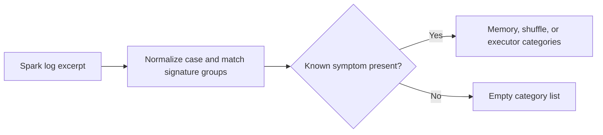

# Ads Spark Process Debugger

Classify common Spark process failures from synthetic log excerpts.

## Quick start

Run `python3 agent.py example.json` with Python 3.10 or newer. Compare the result with `expected.json`. The JSON keys in the example define the supported input shape.

This offline prototype reads synthetic input and returns a recommendation or diagnostic. It uses no credentials, external APIs, or infrastructure mutations. Results require operator review.

## Local verification

Run `make verify` with Make and Python 3 installed. The sample runs through the CLI and its JSON is compared with `expected.json`.

## Business problem

During a Spark incident, operators need to distinguish memory, shuffle, and executor symptoms in a log excerpt before choosing a runbook.

## Project walkthrough

[Architecture and data flow](docs/ARCHITECTURE.md) · [Business problem, demo, and verification](docs/CASE_STUDY.md)
