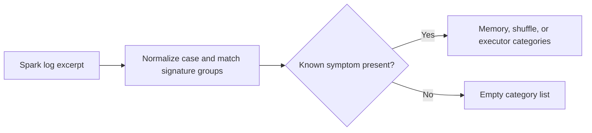

# Ads Spark Process Debugger architecture

Classify common Spark process failures from synthetic log excerpts.

## Operational boundaries

The documented run evaluates the bundled sample locally. Results depend on the quality and scope of the input. The demo makes no live infrastructure changes.
